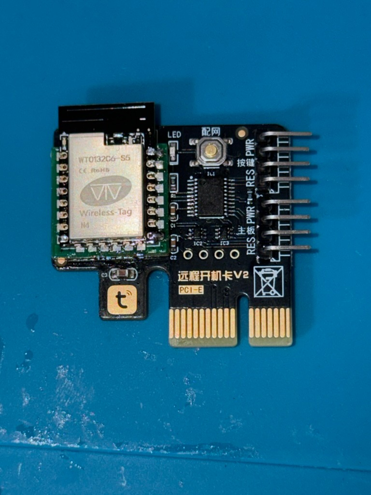

# Tuya PC Power Switch (Matter over Thread)

Matter-over-Thread firmware for a Tuya PC power-switch board (WT0132C6-S5 / ESP32-C6),
replacing the stock Tuya Wi-Fi module. Exposes a single **On/Off** endpoint:

- **On** taps the PC power button (Tuya DP1 write), unless the PC is already on.
- **Off** taps it too, unless the PC is already off. What that does is up to Windows
  (Power Options, "When I press the power button"): shut down, sleep or nothing.

The switch state always reflects the MCU's *sensed* PC power state, so a Windows shutdown
shows up as Off on its own.

The WT0132C6-S5 doesn't fit directly on the Tuya board, so it sits on the
[T1UHL-ESP12 converter board](https://github.com/Cptmeme/ESP12F-converterboards/tree/main/T1UHL-ESP12_board)
from ESP12F-converterboards.



The Tuya MCU is on **UART0 (GPIO16/17)**; the ESP console is moved to USB-Serial-JTAG
so those pins are free (see `sdkconfig.defaults.esp32c6`). The Tuya serial handshake
(product / work-mode / network-status) and framing live in `main/tuya_driver.*`.

Those two pins, the module's TXD and RXD pads, are the only ones the firmware uses:
TX = GPIO16 (to MCU RX), RX = GPIO17 (from MCU TX).

The module has no USB pads (GPIO12/13 aren't broken out), so the console and its logs
can't be reached on this board.

To factory-reset the switch, hold the button on the Tuya board for a few seconds. The MCU
reports this over serial, and the switch clears its Matter pairing and restarts.

First flash goes through the TXD/RXD pads, with GPIO9 low and GPIO8 high at reset and the
MCU's TX line isolated (or before the module is soldered on), since the MCU shares those
pads. After that, Matter OTA works.

See the [docs](https://docs.espressif.com/projects/esp-matter/en/latest/esp32/developing.html) for building and flashing.

## Updating the Firmware

### Versions

Bump all three for every release, or the device ignores the update. The build fails if
the two numbers differ.

- `PROJECT_VER` (e.g. `"1.1"`) and `PROJECT_VER_NUMBER` (e.g. `2`) in `CMakeLists.txt`
- `CONFIG_DEVICE_SOFTWARE_VERSION_NUMBER` in `sdkconfig` / `sdkconfig.defaults.esp32c6` (same number)

### Over USB / serial

A normal `idf.py flash` (wired as above) still works. It is also the only way to write the
bootloader, which the rollback below needs.

### Over the air (Matter OTA over Thread)

The build also produces `build/pc_switch-ota.bin`, a Matter OTA image. Apple Home and
Google Home only update certified devices, so you serve it yourself with the Matter SDK's
host tools. Build them from the SDK with
`./scripts/build/build_examples.py --target darwin-arm64-chip-tool --target darwin-arm64-ota-provider build`.

One-time setup: in the Home app, turn on pairing mode for the switch, then add the
provider and the switch to `chip-tool`'s fabric:

```bash
chip-tool pairing code 2 <setup-code-from-home-app>              # switch = node 2
chip-ota-provider-app -f build/pc_switch-ota.bin --discriminator 3841 --secured-device-port 5565 &
chip-tool pairing onnetwork-long 1 20202021 3841                 # provider = node 1
chip-tool accesscontrol write acl '[{"fabricIndex": 1, "privilege": 5, "authMode": 2, "subjects": [112233], "targets": null}, {"fabricIndex": 1, "privilege": 3, "authMode": 2, "subjects": null, "targets": [{"cluster": 41, "endpoint": null, "deviceType": null}]}]' 1 0
```

Each update (with the provider running and serving the new `pc_switch-ota.bin`):

```bash
chip-tool otasoftwareupdaterequestor announce-otaprovider 1 0 2 0 2 0
chip-tool basicinformation read software-version 2 0              # afterwards: the new number
```

The 1.6 MB image takes about 12 minutes over Thread.

### Rollback

After the download the switch restarts into the new version and keeps it once it has run
for a minute while attached to the Thread network. If it doesn't get there within 5
minutes, or crashes before that, the bootloader automatically returns to the previous
version.

Rollback needs the bootloader from this build, and the bootloader can only be written over
serial. A switch that has only been updated over the air still updates fine, it just
won't roll back.
